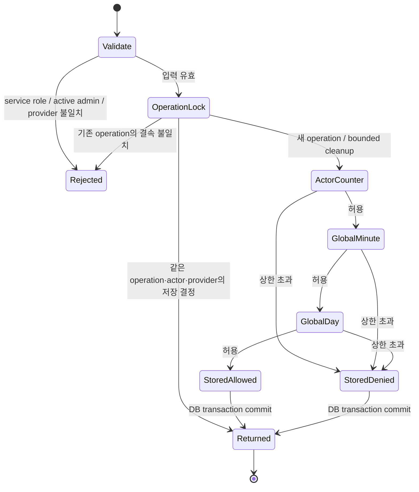

# 동선 예산 RPC 복구 후보 — 운영 미적용

운영 동선 추천은 `naver-directions-budget-unavailable`로 도로 경로 대신 로컬 후보를 표시했다. 읽기 전용 catalog에서 공개 RPC의 실행 소유자는 `privacy_workflow_owner`지만 `provider_budget_private`의 USAGE와 테이블 권한이 없고, Directions 정책도 없음을 확인했다. 현재 공개 RPC와 비공개 counter의 본문 SHA-256은 각각 `bc52ec03840caefdd3f90deb8c00ebf608fc9e1adde0b1b0be5aedf24203386e`, `941ddc06b34547bdfa703094d9175f800cf9921bc869e739e48198c8e0cc9763`으로 원본 G013과 같다. 실제 격리 DB에서 첫 공개 호출의 `42501`과 counter 첫 호출의 `42883`을 재현했다. 후자는 `pg_catalog.greatest`가 함수가 아니라 SQL 조건식 구문인 데서 발생한다.

후보는 [SQL](../../backend/supabase/candidates/20261024_provider_budget_private_bridge.sql)과 [실행 검사](../../backend/supabase/tests/test_provider_budget_bridge_pg17.py)다. applied migration과 고정 release manifest는 수정하지 않는다. `20260713000400`은 현행 hosted closure의 excluded/forbidden 목록에 있으므로 그 과거 extension을 직접 재실행하지 않는다.

## 선택한 권한 경계

워크플로 소유자에게 세 비공개 테이블의 읽기·쓰기와 RLS 정책을 넓게 추가하는 대신, 기존 비공개 소유자 `postgres`의 함수 안에 예산 상태를 유지한다. 공개 RPC의 이름·인자·TABLE 반환·definer·소유자·EXECUTE ACL은 보존하고 비공개 core를 호출한다. 워크플로 소유자는 해당 core의 EXECUTE와 schema USAGE만 받는다. browser와 service_role에는 비공개 테이블·core의 직접 접근을 추가하지 않는다.

기존 세 정책과 한도, operation/actor/provider 결속, 만료 처리 및 counter의 원자적 UPSERT는 유지한다. Directions 한 행만 기존 소스에 명시된 20/actor-minute, 200/global-minute, 10,000/global-day로 추가하고 다른 LLM 정책은 추가하지 않는다. 이는 공급자의 실제 잔여량이나 새로운 유료 한도를 뜻하지 않는다. NULL JWT role은 명시적으로 거부하고 counter의 잘못된 함수 구문을 수정한다.

## 상태 전이와 검증 범위



이 그림은 SQL의 검토 표면이며 형식 증명이 아니다. operation advisory lock과 counter UPSERT는 서로 다른 실제 경계이고, RPC transaction 실패는 전체 변경을 rollback한다. 공급자 호출은 이 transaction 밖에 있으므로 공급자 청구의 exactly-once나 eventual completion을 증명하지 않는다. 저장 결정의 기존 보존 기간을 벗어난 재실행도 무조건적 중복 방지 주장에 포함하지 않는다.

정책 수 P, counter 행 C, 결정 행 D, 정리 상한 B=100일 때 기존 B-tree와 정상 계획을 가정한 한 요청의 탐색/정리 비용은 `O(log P + log C + log D + B(log C + log D))`로 모델링한다. 새 함수 경계는 상수 개수이며 점근적 개선을 주장하지 않는다. lock 대기 시간·실제 provider 지연은 이 모델 밖이다.

## 실제 격리 검증

```text
/Users/twoimo/Documents/projects/tzudong/.venv/bin/python3 -m unittest backend.supabase.tests.test_provider_budget_bridge_pg17
```

PostgreSQL 17.11에서 **16개 통과**. 실제 비슈퍼유저 postgres와 별도로 제공한 owner lease로 실행했다. 같은 operation의 동시 16건은 결정 1행·counter 각 1회, 고유 operation 40건은 허용 20건·차단 20건이었다. actor/global-minute/global-day 상한, 비관리자·비활성 관리자·NULL/다른 JWT role·browser 거부, 결속 불일치, 재적용·기존 정책/ACL/RLS 변경 거부와 rehearsal/후반 오류 rollback을 확인했다. NULL role guard 제거와 잘못된 GREATEST 구문 복원은 각각 잘못된 허용과 `42883`을 실제 DB에서 검출했다. 이 두 negative control은 시험 DB만 변경한다.

[실행 영수증](../evidence/provider-budget-bridge-20261024/summary.json)은 소스별 SHA, 실제 전후 영수증과 종료 확인에 결속된다. 세 기존 정책과 공개 함수 metadata/ACL, private table ACL/RLS/policy, 역할·membership·default ACL의 불변을 확인했다. 결정적 한정 사례이므로 95% 모집단 구간이나 운영 성공률·속도·비용 절감으로 환산하지 않는다. 운영 DB 쓰기·실제 provider 호출은 0회다.

## 운영 전달 전에 남은 조건

현재 후보는 실행 명세·ledger·writer fence를 가진 migration이 아니다. 현재 권한이 거절된 MCP 연결자에서 SET ROLE이나 GRANT로 우회 실행하지 않는다. 별도로 검증한 postgres migration executor와 임시 owner lease, 현재 ledger prefix, 전체 G014 전후 계약, 실제 운영 버전 PG17.6 및 새 admission의 atomic apply/readback이 필요하다. 로컬 fixture의 modeled lease는 이 권한의 운영 영수증이 아니다.

정확한 소스의 Pro thesis → Gemini 최대 사고 반대 검토 → Pro 역검증도 미완료다. 기존 원본 예약과 bundle은 보존한다. 현재 production은 별도 작업으로 `1b5230ac93021c72499f4950bff6cda24e2515e5` / `dpl_FiHvmpQdmnDLNYXL9dquSFTFMpoB`로 이동한 것을 읽기 확인했으며 이 후보의 배포는 아니다. 실제 적용 직전에 rollback SHA와 writer fence를 다시 확인하고, 정상 `develop → data → main` 이후 인증된 UI에서 도로 경로·제어된 실패·기존 캐시/반환 계약을 확인해야 한다. 이미 생성된 결정이나 counter를 삭제하는 자동 rollback은 만들지 않는다.
