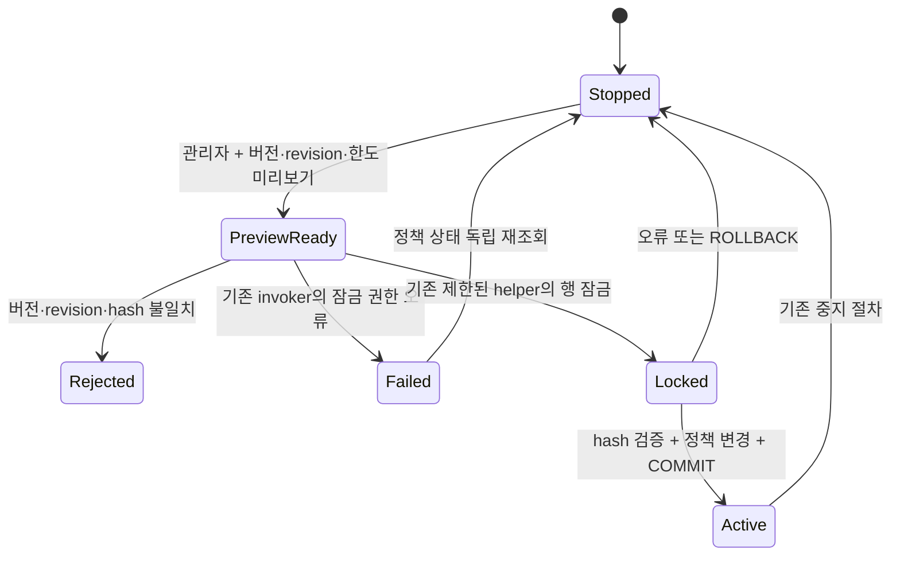

# 맛집 자동 승인 활성화 잠금 오류

## 실제 운영 관측

운영 소스 `6ccd33d5ccc09e607e8053a883087a9d0f3eab77` / 배포 `dpl_4ppHwfZBk4yaiVCEAoG2Y1aaZqoU`에서 기존 한도 50/50의 후보 미리보기는 성공했지만 자동 승인 시작 요청 1회는 고정 오류로 끝났다. 같은 요청을 재전송하지 않았다. 2026-10-24T15:40:36.531Z의 인증된 브라우저 GET 재조회는 `enabled=false`, `version=1`, 회당 50·하루 50, 정책 이벤트 0, 대기/실행/실패 큐 각각 0이었다. 실제 HTTP 오류 상태는 확보하지 못했다. 이 관측은 비활성 상태의 증거이며 불확실한 요청의 범용 rollback 증명은 아니다.

서비스 역할은 revision 테이블의 SELECT만 허용받고 UPDATE는 거부된다. 기존 `SECURITY INVOKER` configure는 이 역할로 revision 행에 `FOR UPDATE`를 실행한다. 기존 수동 검수는 이미 설치된 무인자·고정 행 잠금 helper를 호출한다. helper는 postgres 소유 SECURITY DEFINER, 빈 search_path, 잠금 timeout 2초이며 PUBLIC/anon/authenticated에는 실행 권한이 없다.

실제 운영 catalog와 PG17.6 재현의 configure·helper·bump 본문 SHA가 일치했다. bump는 `ed162268…`이며 별도의 safeupdate forward는 이 작업에서 실행하지 않았다. 운영 사용자 행은 복사하지 않았다.

## 상태와 불변식

유지할 조건은 관리자 검증, 현재 버전·revision·한도에 결속된 preview hash, commit 시 버전 1 증가, commit까지 revision 잠금 유지, 기존 한도 보존이다. service_role에 revision UPDATE를 부여하지 않는다. 실패 응답만으로 미적용을 단정하거나 자동 재전송하지 않는다. 이 도식은 실제 실행 경로의 명세이며 모든 입력·스케줄에 대한 형식 증명은 아니다.

## 재현과 검증 범위

합성 사용자 3명과 기본 singleton 행의 PG17.6 clone에서 원본 preview는 성공하고 start는 `42501`로 실패했다. 잠금 호출 한 줄을 기존 helper 호출로 바꾸면 commit 후 독립 조회가 `true/version2/50/50`, 이벤트 1로 바뀌었다. stale version/hash·재사용은 거부됐고 anon/authenticated·비관리자·disabled 관리자는 거부됐다. service_role의 직접 revision UPDATE도 계속 거부됐다.

늦은 오류와 정상 start의 rollback은 함수·정책 변경을 되돌렸다. configure 반환 후 COMMIT 전 다른 revision writer는 `55P03`으로 거부됐고, COMMIT 뒤에는 성공했다. 먼저 revision을 변경한 writer가 commit하면 기다리던 activation은 오래된 preview를 거부했다. 이 결과를 운영 활성화나 생성 성공으로 확장하지 않는다.

최초 설치 초안은 postgres가 G014 assertion을 직접 호출해 별도의 `42501`을 냈다. 정확한 4,382바이트 실행 실패와 변경 없는 결과를 보존했다. assertion 권한을 넓히거나 검사를 생략하지 않고 기존 owner 소유 임시 검증 bridge 방식으로 보정한다.

| 증거 | SHA-256 |
| --- | --- |
| 운영 요청·독립 상태 조회 | `04af79451a3a1437b91745502507e62ad4cc483ab56de86d962f9d405ce5006e` |
| 운영 configure/helper catalog | `7c8fd401a1eb4eb37939e5ef9171de1d89d5cd4143a4ca318e0623e68290f1ca` |
| 운영 bump catalog | `e72a170ba15dd17e0d0132f7225495d52a79f03207d7cc370e5f7ac1bfc066e5` |
| PG17.6 기능 재현 | `de2afbbed040e7304ce9b6d779a3c7cbbe677c6802d2c850f83f3f04ce69eb08` |
| PG17.6 COMMIT 잠금 경계 | `b99fb6d60afc693f88b621b956668d45765c1c32c9139f62a5eb29b320226e26` |
| 최초 설치 초안 실패 | `7d1830a275d46efe53754729868d617cc7045c1aef1f6f8ac447f86a09134ceb` |

이는 결정적 계약·분기 검사다. 무작위 표본의 개선율·95% 신뢰구간, 운영 처리량·비용 절감은 측정하지 않았으므로 주장하지 않는다.

## 운영 적용 순서

예산 PR #3519의 보호 브랜치 승격과 별도 90→91 설치·독립 reconciliation 뒤, 이 forward의 정확한 91→92 계약을 새로 확인한다. 새 prior 91의 예상 digest는 운영 90행과 고정 budget 원문 vector를 read-only로 결합해 계산한 `fa0d91d7badd9ae960938fbb49a153d1b11eed77c147a869fd752bfb411c84e0`다. 이는 실제 91행 관측이 아니며 실행 직전의 정확한 prior 검사를 대신하지 않는다. 기존 draft·manifest·적용 migration·입력 한도는 변경하지 않는다.

운영 SQL은 원래 attempt의 단일 durable journal, 공통 serializer → compiler 원장 잠금 → 전체 G014 pre/post → terminal → COMMIT 순서를 보존한다. 불확실한 결과는 원래 attempt를 재조회한다. 수정 후 기존 화면의 새 미리보기에서 한도 50/50을 재확인하고 활성화를 한 번 수행해 정책·이벤트를 독립 재조회한다. 현재 운영 활성화는 미완료다. 외부 Pro→Gemini→Pro 검토도 기존 예약을 보존한 채 미완료로 남아 있다.

## 보정 v2와 소스 결속

보정 v2는 기존 owner 소유 `pg_temp` bridge만 생성하고, bridge 생성에 쓴 self-granted SET-only membership을 **G014 pre 전에 회수**한다. configure 본문 패치 동안 owner lease는 없다. 모든 membership·assertion 전체 metadata·roles·default ACL·기존 helper·pipeline 테이블 ACL/RLS와 namespace metadata를 전후 비교한다. 영구 assertion 권한과 service_role 테이블 권한을 늘리지 않는다.

정확한 v2 **16,677 bytes / 4문장**, SQL SHA `16da1c813db1cda3565bfe6f2f13c7c341667774215162956645d8d340ba1703`, vector SHA `65b506ca4d44ba47b96d5b2efa6c6b593d56bfe2db1f4226cf0069aaf3997c91`로 PG17.6 clone의 원장 **91→92**를 실행했다. 원장 삽입 뒤 강제 실패 시 전체 prior가 복원됐고, commit 뒤 원문 vector와 독립 readback/reconcile가 일치했다. autocommit·살아 있는 lease·helper/body/ACL/ledger drift와 재적용은 거부됐다. forward 내부 G014 pre 4개와 post 4개, 별도 네 시점의 전체 assertion도 통과했다. 실행 영수증 SHA는 `f923e9f95304ae8616c90437a35ca6d5518c87c346f6cf97b3feffdbeff72786`다. 설치 검증 뒤 기능 검사용 합성 사용자 3명과 기본 singleton 행을 추가했다. 설치와 기능 검증의 입력은 구분하며 실제 운영 caller/admission 증거로 확대하지 않는다.

새 [disabled 설치 manifest](../../.github/review-activation-lock-installation.v1.json)는 운영 RR/RO catalog 관측의 16개 필드에 결속한다. clone과 function/assertion metadata는 모두 같았고, ledger 상태 외에는 `rolesDigest`·`defaultAclDigest`가 달랐다. 새 manifest는 실제 운영 digest를 보존하며 clone에 맞추는 DDL을 하지 않는다. 미래 prior91 digest는 앞선 read-only 계산에 결속한다. 실제 운영91 관측과 새 실행 admission은 여전히 필요하다. Root는 해당 manifest와 정확한 candidate에서 공식 parser/compiler를 별도 inspect해 4문장·vector·91→92 계약을 확인했다(DB 호출 0).

현재 기본 migration/thumbnail/budget caller는 새 manifest를 허용하지 않는다. 과거 caller에 override를 넣거나 manifest를 true로 바꾸는 방법으로 적용하지 않는다. 별도 source-bound 단일 attempt 실행과 독립 reconciliation을 준비한 뒤 보호 브랜치·선행91·fresh 운영 검사를 거쳐 적용한다. 적용되지 않은 source 후보와 로컬 검증 결과를 운영 완료로 표시하지 않는다.
