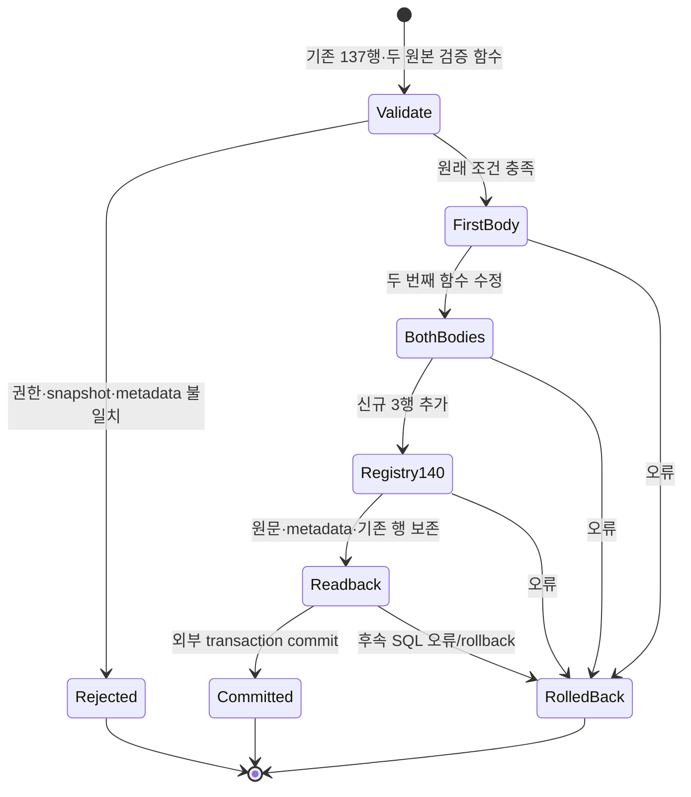
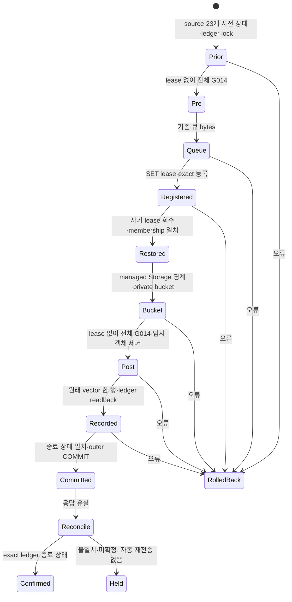

# 썸네일 G014 등록 후보 — 운영 미적용

[등록 SQL](../../backend/supabase/candidates/20261024_thumbnail_g014_registration.sql)은 기존 썸네일 큐 후보의 신규 RPC 3개를 현재 G014 분기와 등록부에 연결하는 **companion 후보**다. applied migration·고정 실행 명세는 수정하지 않는다. 큐·bucket·ledger를 설치하는 forward 명세나 전체 G014 인증은 아직 아니다.

기준은 [읽기 전용 source snapshot](../../backend/supabase/tests/fixtures/thumbnail-g014-hosted-preimage-20261024.json)의 기존 등록 137개와 두 검증 함수다. 등록 행 snapshot은 2026-10-23 자료이고, 2026-10-24 06:57:51 UTC 단일 읽기 조회에서 PG17.6의 전체 137행 digest와 두 함수 본문 SHA가 기준과 같음을 다시 확인했다. 해당 caller의 BYPASSRLS=true도 확인해 정책으로 가려진 137행만 센 경우와 구분했다. role/schema/table/policy 메타데이터는 별도의 10월24일 읽기 조회와 대조했다. [읽기 영수증](../evidence/thumbnail-g014-registration-20261024/hosted-preimage-readonly-065751.json)은 실제 assertion 실행·설치 admission·writer fence나 나중 적용 시점의 일치를 증명하지 않는다. 실행 시 기존 137행 digest가 다르면 수정 없이 거부한다.

## 실제 변경과 경계

신규 identity는 `thumbnail_production_auth_worker(text)`, `thumbnail_production_admin(uuid,text,uuid,uuid,text,text,jsonb)`, `thumbnail_production_worker(text,text,uuid,uuid,bigint,text,jsonb)`다. `identity_arguments`는 사람이 읽는 타입 목록이 아니라 실제 `pg_proc.proargtypes::text`에서 생성한다. 등록은 `service_role` 한 grantee만 추가한다.

현재 두 assertion의 service-only invoker 분기 25개에 위 세 identity만 추가한다. 원래 본문에서 추가 문자열을 제거하면 원문과 정확히 같아야 하며, 함수의 본문 외 `pg_proc` 메타데이터는 같아야 한다. 기존 137행과 registry/schema의 소유자·ACL·RLS·정책·제약·trigger, 역할·membership은 유지한다. 신규 RPC의 실제 본문 SHA·언어·반환형·인자 이름/기본값·함수 속성·search_path·소유자·최소 EXECUTE ACL을 확인한다. overload와 browser/PUBLIC 실행, grant option은 거부한다.

실행자는 비슈퍼유저 `postgres`와 별도로 검증해 제공한 owner SET lease를 요구한다. 후보는 역할을 생성하거나 lease를 부여하지 않는다. 임시 role 전환은 성공 후 `postgres`로 되돌린다. **전체 G014 pre와 post는 모두 SET lease가 없는 상태에서 실행한다.** 현재 owner 계약은 self-granted membership을 거부하므로, 등록 후 자기 grantor의 lease를 먼저 회수하고 원래 membership을 확인한 뒤 post를 호출해야 한다. 기존 `supabase_admin`의 ADMIN-only bootstrap 행은 보존한다. assertion 실행에는 기존 forward의 owner 소유 `pg_temp` bridge 패턴을 재사용할 수 있다. 이 회수와 현재 writer fence는 외부 설치 명세의 책임이며, 로컬 fixture가 운영 권한을 증명하지 않는다.

## 상태와 수학적 범위



하나의 DO와 호출자 transaction에서 자기 변경을 보존하거나 되돌린다는 범위다. 성공 시 `(기존 두 본문,137행) → (각 3개 identity만 추가한 두 본문,140행)`이고 오류 시 입력 상태를 보존한다. 이미 입력이 drift한 경우 그 상태를 임의로 정상화하지 않는다. 이 그림은 전체 시스템 형식 증명이나 다른 모든 reader의 관측·임의 DDL writer에 대한 보장이 아니다. advisory lock은 협력하는 등록 호출만 직렬화하므로 실제 설치에는 별도 writer fence가 필요하다.

집계 전 visible row 138개를 제한 조회해 정확히 137개인 경우만 진행하고, 등록 문자열 각 4,096 bytes와 함수 본문/기본값 각 65,536 bytes를 검사한다. 정상 메타데이터가 고정되고 문자열 비교·정렬과 보수적인 부분 문자열 검색을 가정하면 `R≤137`, 행 문자열 길이 `B`, 검증 함수 본문 길이 `L`에 대해 처리 비용을 `O(R·B·log R + L²)`, 메모리를 `O(R·B + L)`로 모델링한다. 물리 MVCC scan·catalog 접근 계획·lock 대기·임의의 privileged DDL은 이 모델 밖이다. 점근적·운영 성능 개선을 주장하지 않는다.

## 실제 검증

```text
/Users/twoimo/Documents/projects/tzudong/.venv/bin/python3 -m unittest backend.supabase.tests.test_thumbnail_g014_contract_pg17
```

실제 소유 PG17.11에서 최초 **16 methods pass·0 fail·0 error**, 2.407초였고, 설치 순서 회귀를 추가한 최종 실행은 **17 methods pass·0 fail·0 error**, 1.303초다. 작업량이 달라 속도 개선으로 비교하지 않는다. 실제 큐 SQL로 신규 RPC를 생성하고 실제 비슈퍼유저 postgres session에서 companion을 commit했다. 기존 137행·신규 3행, 두 assertion의 본문 외 메타데이터와 역할·membership 보존을 확인했다. 동시 호출 2건은 commit 1건·재등록 거부 1건이었다. 두 번째 assertion의 source drift와 외부 후속 오류 rollback, replay, 잘못된 actor/lease/isolation, ACL/RLS/trigger·본문·기본값·반환형·크기·overload drift를 확인했다.

추가 회귀는 현재 운영에서 읽은 `assert_g014_workflow_owner_contract()`의 실제 본문 SHA `345aed9acb1da06262740ef06d81e51855a44c7470aa8b431a23e6fa629aab1d` 전체를 실행한다. 격리 DB의 실제 PG17 membership과 `SET SESSION AUTHORIZATION postgres`에서 lease가 남은 post 순서는 `g014_pg17_workflow_owner_membership_denied`로 거부되고, 자기 grantor의 lease만 회수한 순서는 통과했다. ADMIN-only bootstrap 행 보존과 bridge 자체 제거를 확인했다. 기존 주석의 post→회수 지시를 회수→post로 수정했다. 이 검사는 **owner 함수 전체 한 개의 실행**이며 전체 G014 graph·운영 실행·원자적 설치 구현을 뜻하지 않는다.

두 검증 함수의 실제 선언·metadata lookup·invoker IF 분기를 그대로 추출해 신규 3개 identity에 실행했다. 전체 함수의 선행 helper·기존 137 identity dependency graph는 실행하지 않았다. 이는 **두 branch의 보충 검증**이며 전체 G014나 운영 PG17.6 통과가 아니다.

grant-option guard를 제거한 메모리 변형은 금지된 재위임 권한을 허용했고, 원래 G014 분기 검사가 다시 거부했다. 두 registry digest guard를 제거한 변형은 기존 행의 잘못된 OID 인자 값을 허용했다. 현재 후보는 두 사례를 정확한 고정 오류 사유로 거부한다. 변형은 시험 transaction 안에서만 실행했고 checkout 파일은 변경하지 않았다.

초기 harness의 암시적 ACL과 누락된 probe 문맥 변수 때문에 실패했던 실행은 성공 수치에 포함하지 않았다. 거부 검사는 SQLSTATE뿐 아니라 고정 원인을 비교해 엉뚱한 사전 실패를 통과로 세지 않는다. [증거 summary](../evidence/thumbnail-g014-registration-20261024/summary.json)는 실패·최종 실행을 분리하고 source SHA 및 PID/socket/TCP 종료에 결속한다. 결정적 시험이므로 모집단 95% 구간·비용 절감·운영 성공률로 환산하지 않는다. 운영 쓰기와 provider 호출은 0회다.

## 남은 운영 설치

전체 G014 pre를 큐 생성 **전·lease 없는 상태**에 실행하고, 큐·이 companion·private bucket을 설치한 뒤 **자기 lease 회수 → membership readback → 전체 G014 post → ledger 기록·readback**을 한 새로 검증한 설치 transaction에 결속해야 한다. 큐 후보의 내부 BEGIN/COMMIT은 기존 `migrationEnvelope`로 검증해 제거해야 하며 단순 연결하지 않는다. 아래 새 forward와 실행 비활성 draft가 이 순서를 구현하지만 실제 적용기의 새 admission은 아직 아니다. 뒤의 PG17.6 전체 설치 리허설은 이 로컬 공백을 검증한 후속 증빙이다. 현재 writer fence·credential/worker provisioning, 실제 독립 Pro → Gemini → Pro 검토, 보호 승격 및 배포 후 인증 업무 readback은 계속 미완료다. 기존 7개 외부 예약과 미적용 후보를 유지하며, 이 companion의 로컬 통과로 그 단계를 완료 처리하지 않는다.

## 하나의 새 forward와 Storage 경계 — 운영 미적용

[전체 후보](../../backend/supabase/candidates/20261024071000_thumbnail_production_install.sql)는 **64,927 bytes·43 statements**, SHA-256 `8019c4e7788cf6706094937a5d4111958201793192d918817e824791db471ac2`다. 기존 큐에서 compiler가 검증해 제거한 envelope 외 **30,384 bytes**, companion **16,406 bytes**를 그대로 담는다. applied migration, 기존 고정 manifest 및 역할·managed Storage 권한은 수정하지 않았다.

[draft 명세](../../.github/thumbnail-production-installation.draft.v1.json)는 `executionEnabled=false`다. 실제 caller는 아직 이 draft를 허용하지 않는다. 기존 단일 migration compiler에 전체 source를 그대로 전달하고, ledger의 exclusive lock·정확한 사전 상태·원래 문장 벡터 기록·종료 검사를 사용하는 후보다. 현재 관측한 **89행 prefix**의 digest와 최종 version을 보존하고 신규 한 행만 추가하는 **90행** 종료 상태를 지정한다. 기존 86/97/101 등의 실행 명세를 고치거나 이전 SQL을 재적용하지 않는다. SHA와 관측은 당시 snapshot이며 미래 실행 승인이 아니다.

Storage는 기존 `supabase_storage_admin` 소유와 ACL/RLS·정책 10개를 보존한다. INSERT/SELECT와 별개로 두 lock mode에 필요한 기존 유효 권한을 검사한다. `anon`/`authenticated`의 SUPERUSER·BYPASSRLS·Storage owner USAGE/SET을 거부하며 server 역할은 기존 BYPASSRLS·객체 INSERT/SELECT를 요구한다. 허용 MIME 4개, 최대 **12 MiB**, `public=false`인 `youtube-thumbnail-jobs` bucket 한 개만 만들고 정확히 읽어 확인한다. 기존 정책이 허용하는 bucket은 다른 세 ID뿐이므로 새 bucket의 browser 행은 기본 거부된다. Storage HTTP·서명 URL 동작까지 증명하는 것은 아니다.

실제 발견한 결함은 **동일한 정책이 `search_path`에 따라 다르게 deparse되어 해시 검사가 실패하는 문제**다. source는 `pg_catalog, public`으로 deparser 문맥만 고정한 뒤 원래 local 경로를 복원한다. 읽기 전용 명세는 `is_user_admin`과 `public.is_user_admin`이 들어간 두 **완전한 기존 표현**만 허용한다. 임의 regex 치환이나 느슨한 정책 비교는 사용하지 않는다.



이는 검증할 상태 전이 명세다. **동일한 PostgreSQL outer transaction으로 정확한 source가 실행된다**는 전제에서 commit은 사전 상태·full pre/post·원래 registry 보존·신규 3행·private bucket·lease 회수·exact ledger/종료 검사를 모두 통과한 경우만 허용하도록 설계했다. commit 전 오류의 durable 변경은 rollback되어야 한다. 임의 transport의 source 재조합, 비협력 privileged DDL, 실제 전체 설치 실행의 성공을 이 그림으로 증명하지 않는다. XID local marker는 psql 문장별 autocommit 사고를 두 번째 DO에서 차단하는 보조 장치다.

실제 PG17.11에서 [새 검사](../../backend/supabase/tests/test_thumbnail_install_boundary_pg17.py) **12 methods pass·0 fail·0 error**다. 전체 source의 자동 커밋 오실행 차단, bucket commit 후 별도 연결 readback, 서버 INSERT/SELECT와 browser 두 역할의 SELECT/UPDATE/DELETE 0행·INSERT 42501, 기존 정책/버킷/권한/역할 drift 거부, 늦은 오류의 bucket rollback을 확인했다. 수정 전 deparser 문맥의 메모리 변형은 정상 정책을 잘못 거부했고 현재 source는 입력 경로 4종에서 통과·복원했다. 같은 4종 문맥에서 draft의 실제 SELECT를 실행해 정확한 큐·등록·정책 component 종료 값을 확인했다. 시험 ledger는 **0행**이며 운영 89행 전체 또는 전체 G014를 로컬에서 실행했다고 하지 않는다.

기존 compiler·응답 유실 판정의 Bun 검사는 **21 pass·0 fail·145 assertions**다. draft source·component 6개의 byte hash, 원래 43개 문장 vector, source→ledger→종료 검사 순서와 `committed`/`not_applied`/`partial_conflict` 분리를 확인한다. 현 parent `818b615a` CI는 **24 SUCCESS·1 SKIPPED·실패/대기 0**이며 새 후보의 CI와 별개다.

운영 PG17.6에서 draft의 사전 SELECT 한 번을 실행해 **23개 항목 전부 일치**를 확인했다. 함수 호출·DB 쓰기는 0회다. 로컬 시험의 초기 transaction fixture가 권한 변경을 commit하던 문제와 readback fixture의 읽기 권한 누락, ACK 판정을 예외로 오인한 검사 실패는 수정했고 실패 영수증도 보존했다. 이는 제품에서 재현한 deparser 문제와 구별한다. PID/socket/TCP 종료 및 source 전후 hash가 같은 [최종 영수증](../evidence/thumbnail-g014-registration-20261024/forward-boundary-final-12-pass.json)을 남겼다. 결정적 검사·단일 snapshot에는 모집단 95% 구간이나 성능·금액 절감률을 만들지 않는다.

native 독립 검토는 실제 Pro → Gemini → Pro 외부 검토가 아니다. 그 3단계, 새 고정 admission·현재 writer fence·worker provisioning·보호 승격·배포 후 실제 업무는 계속 남아 있다. 스킬의 “Missing independent review leaves that stage incomplete; independent authorized implementation/checks may continue.”에 따라 구현·로컬 검증은 진행하고 외부 검토 완료는 보류한다.

## PG17.6 전체 설치 리허설 — 244f886c, 운영 미적용

[전체 영수증](../evidence/thumbnail-g014-registration-20261024/forward-full-pg176-install.json)은 앞의 component 검사와 별개로, **기존 89행의 원래 ledger vector와 무수정 G014 전체**를 가진 격리 DB에서 정확한 forward를 실행한 증거다. 시험한 source는 `244f886cd125dc925ab3f356f4eba7cabd134d4d`, candidate SHA는 기존 `8019c4e7…71ac2`이며 product SQL·실행 비활성 draft·고정 적용기는 변경하지 않았다. 이 source의 CI는 **25 SUCCESS·1 SKIPPED·실패/대기 0**으로 끝났다. 뒤의 증빙 문서 commit으로 이 source의 CI 결과를 옮겨 주장하지 않는다.

운영의 **23개 사전 항목 일치**와 11개 입력을 하나의 exported REPEATABLE READ READ ONLY snapshot으로 수집했다. 사용자 행은 0건이고 운영 쓰기도 0회다. 이전 `/private/tmp` 입력이 중단 뒤 사라져 새로 수집했으며, 이전 hash를 재사용하지 않았다. 새 입력과 실패·성공 영수증은 비공개 `/Users/twoimo/.codex/runtime-cache/thumbnail-production-rehearsal-20261024`에 보존한다. 원본 snapshot과 적용된 migration은 수정하지 않았다.

동일한 기존 Supabase 이미지의 실제 **PostgreSQL 17.6**을 network none·공개 port 0인 소유 fixture로 실행했다. 일반 모드에서 `supabase_admin` OID 10·역할/membership을 준비하고, `-b`는 OID 보존 schema 복원에만 사용했다. 원본 heap·XID/MultiXact를 옮기지 않으므로 dump의 물리 horizon 설정 **341문장**을 파생 입력에서 제외했다. 원래 `BETWEEN`을 deparse/reparse하면 중첩 AND가 달라지는 현상도 같은 버전에서 재현했고, CHECK 한 건을 원래 migration 구문으로 복원했다. 보호 manifest·registry 행을 검사에 맞춰 수정하지 않았다.

논리 dump가 명시된 소유자 기본 ACL을 NULL 기본 ACL로 복원하는 차이는 별도로 처리했다. **뒤의 별도 읽기 전용 운영 관측**에서 사전 23항목과 원래 raw ACL이 후보의 엄격한 조건과 일치함을 확인했고, 소유 fixture에 일반 GRANT/REVOKE로 그 명시 형태를 복원했다. 이 ACL 보충 관측은 앞의 11개 입력과 같은 snapshot이라고 하지 않는다. 정상 재기동 뒤 임시 SUPERUSER·system table modification을 제거하고 다음을 확인했다.

| 경계 | 실제 결과 |
| --- | --- |
| 역할·membership·확장 | 37역할·29membership·11확장의 owner/version 일치 |
| 타입·원문 ledger | 442개 타입의 OID/배열/관계 identity 일치, 원래 89행 vector 일치. 8자리 legacy version 3개와 빈 vector 7개도 보존 |
| 보호 카탈로그·G014 | 보호 manifest 1,963행의 양방향 차이 0, 원래 G014 4개 전체 통과, 원래 137행 raw digest 보존 |
| 마지막 오류 주입 | 정확한 source 43문장·ledger insert·종료 검사를 모두 지난 뒤 오류 발생. 새 연결의 사전 상태 23항목·ledger 89행·원래 G014 복원, reconciliation `not_applied` |
| 정상 commit | ledger 89→90행, 원래 source vector 한 행만 추가, 새 연결의 종료 상태 23항목·전체 G014 통과, reconciliation `committed` |

추가 메타데이터 비교에는 명시적 한계가 있다. 같은 caller/deparser 문맥에서 attribute **2,497행 중 2,496행이 일치**했고, 비보호 index 한 건의 과거 표시 열 이름 `admin_id`가 현재 table 열 이름 `created_by`로 복원됐다. 원본과 index DDL은 같고 해당 index는 보호 relation에 포함되지 않는다. 이 차이를 registry 투영이나 원본 catalog 수정으로 숨기지 않았으며 **물리 catalog 전체의 동일성은 주장하지 않는다**. 보호 manifest 1,963행의 무수정 전체 검사는 별도로 통과했다.

소유 컨테이너는 검사 후 정지하고 volume과 실패 입력을 보존했다. 기본 Docker context와 기존 Colima 설정은 보존했으며 다른 소유자의 컨테이너를 직접 시작·중지하지 않았다. source 복원기의 mode 순서·endpoint 고정·GUC 표현·legacy version·psql meta-command 줄바꿈 오류와 dump 표현 차이는 제품 결함·운영 변경과 구분한다. 실제 네트워크 ACK 유실, Storage HTTP/서명 URL, provider 생성·worker provisioning·hosted 적용은 이 리허설의 증거가 아니다. 결정적 상태 검사에 95% 모집단 구간이나 속도·비용 절감률을 부여하지 않는다.
