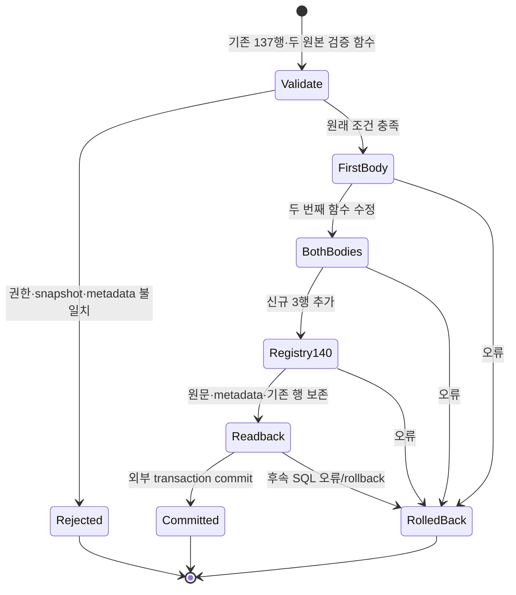

# 썸네일 G014 등록 후보 — 운영 미적용

[등록 SQL](../../backend/supabase/candidates/20261024_thumbnail_g014_registration.sql)은 기존 썸네일 큐 후보의 신규 RPC 3개를 현재 G014 분기와 등록부에 연결하는 **companion 후보**다. applied migration·고정 실행 명세는 수정하지 않는다. 큐·bucket·ledger를 설치하는 forward 명세나 전체 G014 인증은 아직 아니다.

기준은 [읽기 전용 source snapshot](../../backend/supabase/tests/fixtures/thumbnail-g014-hosted-preimage-20261024.json)의 기존 등록 137개와 두 검증 함수다. 등록 행 snapshot은 2026-10-23 자료이고, 2026-10-24 06:57:51 UTC 단일 읽기 조회에서 PG17.6의 전체 137행 digest와 두 함수 본문 SHA가 기준과 같음을 다시 확인했다. 해당 caller의 BYPASSRLS=true도 확인해 정책으로 가려진 137행만 센 경우와 구분했다. role/schema/table/policy 메타데이터는 별도의 10월24일 읽기 조회와 대조했다. [읽기 영수증](../evidence/thumbnail-g014-registration-20261024/hosted-preimage-readonly-065751.json)은 실제 assertion 실행·설치 admission·writer fence나 나중 적용 시점의 일치를 증명하지 않는다. 실행 시 기존 137행 digest가 다르면 수정 없이 거부한다.

## 실제 변경과 경계

신규 identity는 `thumbnail_production_auth_worker(text)`, `thumbnail_production_admin(uuid,text,uuid,uuid,text,text,jsonb)`, `thumbnail_production_worker(text,text,uuid,uuid,bigint,text,jsonb)`다. `identity_arguments`는 사람이 읽는 타입 목록이 아니라 실제 `pg_proc.proargtypes::text`에서 생성한다. 등록은 `service_role` 한 grantee만 추가한다.

현재 두 assertion의 service-only invoker 분기 25개에 위 세 identity만 추가한다. 원래 본문에서 추가 문자열을 제거하면 원문과 정확히 같아야 하며, 함수의 본문 외 `pg_proc` 메타데이터는 같아야 한다. 기존 137행과 registry/schema의 소유자·ACL·RLS·정책·제약·trigger, 역할·membership은 유지한다. 신규 RPC의 실제 본문 SHA·언어·반환형·인자 이름/기본값·함수 속성·search_path·소유자·최소 EXECUTE ACL을 확인한다. overload와 browser/PUBLIC 실행, grant option은 거부한다.

실행자는 비슈퍼유저 `postgres`와 별도로 검증해 제공한 owner SET lease를 요구한다. 후보는 역할을 생성하거나 lease를 부여하지 않는다. 임시 role 전환은 성공 후 `postgres`로 되돌린다. **전체 G014 pre와 post는 모두 SET lease가 없는 상태에서 실행한다.** 현재 owner 계약은 self-granted membership을 거부하므로, 등록 후 자기 grantor의 lease를 먼저 회수하고 원래 membership을 확인한 뒤 post를 호출해야 한다. 기존 `supabase_admin`의 ADMIN-only bootstrap 행은 보존한다. assertion 실행에는 기존 forward의 owner 소유 `pg_temp` bridge 패턴을 재사용할 수 있다. 이 회수와 현재 writer fence는 외부 설치 명세의 책임이며, 로컬 fixture가 운영 권한을 증명하지 않는다.

## 상태와 수학적 범위



하나의 DO와 호출자 transaction에서 자기 변경을 보존하거나 되돌린다는 범위다. 성공 시 `(기존 두 본문,137행) → (각 3개 identity만 추가한 두 본문,140행)`이고 오류 시 입력 상태를 보존한다. 이미 입력이 drift한 경우 그 상태를 임의로 정상화하지 않는다. 이 그림은 전체 시스템 형식 증명이나 다른 모든 reader의 관측·임의 DDL writer에 대한 보장이 아니다. advisory lock은 협력하는 등록 호출만 직렬화하므로 실제 설치에는 별도 writer fence가 필요하다.

집계 전 visible row 138개를 제한 조회해 정확히 137개인 경우만 진행하고, 등록 문자열 각 4,096 bytes와 함수 본문/기본값 각 65,536 bytes를 검사한다. 정상 메타데이터가 고정되고 문자열 비교·정렬과 보수적인 부분 문자열 검색을 가정하면 `R≤137`, 행 문자열 길이 `B`, 검증 함수 본문 길이 `L`에 대해 처리 비용을 `O(R·B·log R + L²)`, 메모리를 `O(R·B + L)`로 모델링한다. 물리 MVCC scan·catalog 접근 계획·lock 대기·임의의 privileged DDL은 이 모델 밖이다. 점근적·운영 성능 개선을 주장하지 않는다.

## 실제 검증

```text
/Users/twoimo/Documents/projects/tzudong/.venv/bin/python3 -m unittest backend.supabase.tests.test_thumbnail_g014_contract_pg17
```

실제 소유 PG17.11에서 최초 **16 methods pass·0 fail·0 error**, 2.407초였고, 설치 순서 회귀를 추가한 최종 실행은 **17 methods pass·0 fail·0 error**, 1.303초다. 작업량이 달라 속도 개선으로 비교하지 않는다. 실제 큐 SQL로 신규 RPC를 생성하고 실제 비슈퍼유저 postgres session에서 companion을 commit했다. 기존 137행·신규 3행, 두 assertion의 본문 외 메타데이터와 역할·membership 보존을 확인했다. 동시 호출 2건은 commit 1건·재등록 거부 1건이었다. 두 번째 assertion의 source drift와 외부 후속 오류 rollback, replay, 잘못된 actor/lease/isolation, ACL/RLS/trigger·본문·기본값·반환형·크기·overload drift를 확인했다.

추가 회귀는 현재 운영에서 읽은 `assert_g014_workflow_owner_contract()`의 실제 본문 SHA `345aed9acb1da06262740ef06d81e51855a44c7470aa8b431a23e6fa629aab1d` 전체를 실행한다. 격리 DB의 실제 PG17 membership과 `SET SESSION AUTHORIZATION postgres`에서 lease가 남은 post 순서는 `g014_pg17_workflow_owner_membership_denied`로 거부되고, 자기 grantor의 lease만 회수한 순서는 통과했다. ADMIN-only bootstrap 행 보존과 bridge 자체 제거를 확인했다. 기존 주석의 post→회수 지시를 회수→post로 수정했다. 이 검사는 **owner 함수 전체 한 개의 실행**이며 전체 G014 graph·운영 실행·원자적 설치 구현을 뜻하지 않는다.

두 검증 함수의 실제 선언·metadata lookup·invoker IF 분기를 그대로 추출해 신규 3개 identity에 실행했다. 전체 함수의 선행 helper·기존 137 identity dependency graph는 실행하지 않았다. 이는 **두 branch의 보충 검증**이며 전체 G014나 운영 PG17.6 통과가 아니다.

grant-option guard를 제거한 메모리 변형은 금지된 재위임 권한을 허용했고, 원래 G014 분기 검사가 다시 거부했다. 두 registry digest guard를 제거한 변형은 기존 행의 잘못된 OID 인자 값을 허용했다. 현재 후보는 두 사례를 정확한 고정 오류 사유로 거부한다. 변형은 시험 transaction 안에서만 실행했고 checkout 파일은 변경하지 않았다.

초기 harness의 암시적 ACL과 누락된 probe 문맥 변수 때문에 실패했던 실행은 성공 수치에 포함하지 않았다. 거부 검사는 SQLSTATE뿐 아니라 고정 원인을 비교해 엉뚱한 사전 실패를 통과로 세지 않는다. [증거 summary](../evidence/thumbnail-g014-registration-20261024/summary.json)는 실패·최종 실행을 분리하고 source SHA 및 PID/socket/TCP 종료에 결속한다. 결정적 시험이므로 모집단 95% 구간·비용 절감·운영 성공률로 환산하지 않는다. 운영 쓰기와 provider 호출은 0회다.

## 남은 운영 설치

전체 G014 pre를 큐 생성 **전·lease 없는 상태**에 실행하고, 큐·이 companion·private bucket을 설치한 뒤 **자기 lease 회수 → membership readback → 전체 G014 post → ledger 기록·readback**을 한 새로 검증한 설치 transaction에 결속해야 한다. 큐 후보의 내부 BEGIN/COMMIT은 기존 `migrationEnvelope`로 검증해 제거해야 하며 단순 연결하지 않는다. 현재 코드는 그 외부 설치 명세를 제공하지 않는다. 현재 PG17.6/catalog 실행 경로·writer fence·credential/worker provisioning, 실제 독립 Pro → Gemini → Pro 검토, 보호 승격 및 배포 후 인증 업무 readback은 계속 미완료다. 기존 7개 외부 예약과 미적용 후보를 유지하며, 이 companion의 로컬 통과로 그 단계를 완료 처리하지 않는다.
